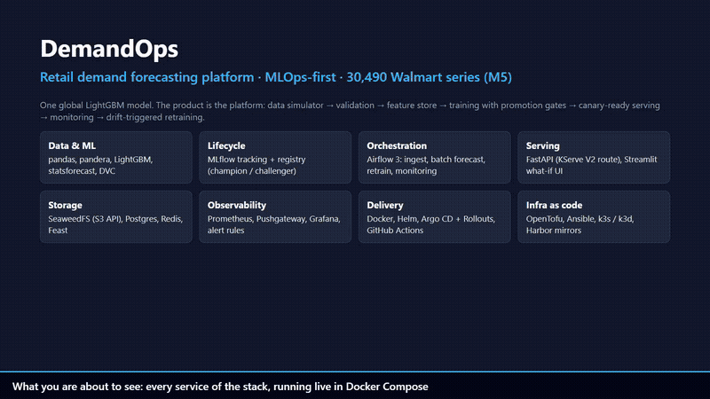
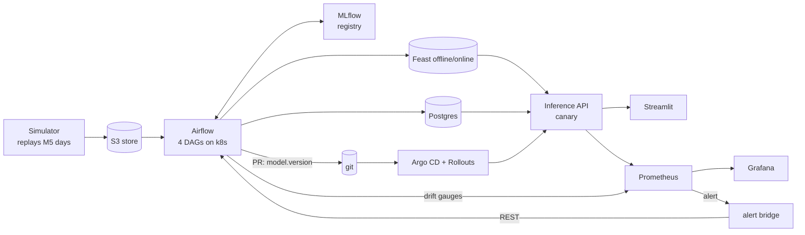

# DemandOps

**Retail demand forecasting platform (MLOps-first): 28-day forecasts for the 30,490 Walmart item x store series of the M5 competition, retrained automatically when drift is detected, shipped through GitOps canary releases, running on any Kubernetes (k3d laptop, k3s VPS) without a public cloud.**

  

## Demo video

[](docs/media/demo.mp4)

**[Watch the full demo (3.5 min, MP4)](docs/media/demo.mp4)** - recorded from the live Docker Compose stack:
the pipeline run, inference API (Swagger), Streamlit forecast + what-if price, MLflow runs and model registry,
Airflow DAGs and their runs, the retrain e-mail (Mailpit), Grafana dashboard, Prometheus alerts firing after an injected
4x demand shock, Pushgateway, and the S3 store. It ends with the measured results and an explicit list of what is
validated but not deployed. Screenshots: [docs/media/screens/](docs/media/screens/). Re-record with `make demo-video`.

> The model is deliberately simple (one global LightGBM). The product is the platform around it.

## 1. Run it

```bash
git clone <this repo> && cd demandops
cp .env.example .env
# real data: Kaggle m5-forecasting-accuracy -> data/   (see docs/offline-setup.md)
# no Kaggle? synthetic data:  python scripts/make_synthetic_m5.py --out data --series 100 --days 500 \
#                             && export SIMULATOR_START_DAY=490
make up          # postgres, redis, S3 store, mlflow, API, streamlit, prometheus, grafana
make demo        # simulate new days -> train + promotion gates -> features -> batch forecast
```
Then: API http://localhost:8001/docs - UI http://localhost:8501 - MLflow :5000 - Grafana :3001 - Prometheus :9090.
Airflow (:8080), Mailpit (:8025), Pushgateway (:9091) and the S3 file browser (:8888) come with `docker compose --profile airflow up -d`.
No Docker? `pip install -e ".[dev,serving,statsforecast]" && make train` runs the whole ML part on SQLite.

## 2. Problem

A retailer must decide every day how many units of each product to send to each store. Too few: stock-outs and
lost sales. Too many: cash stuck in inventory. DemandOps forecasts the next 28 days for every item x store every night
and compares a forecast-driven reorder policy with a naive one (`src/demandops/batch/reorder_sim.py`).

## 3. Architecture


Details, the closed loop and the key design idea (direct 28-day features => no training/serving skew):
[docs/architecture.md](docs/architecture.md).

## 4. Results (real numbers)

Rolling-origin backtest, 3 folds x 28 days, deterministic sample of series.
WRMSSE is computed on the sample, so it is **not comparable to the M5 leaderboard**, only across rows.

| Model (3,000 series) | WRMSSE | MAE | Bias | Fit + predict (3 folds) |
|---|---|---|---|---|
| Seasonal naive | 0.9094 | 1.2062 | -4.52 % | 0.1 s |
| AutoETS (store x dept, top-down) | 0.7523 | 1.0141 | -3.71 % | 46.5 s |
| **LightGBM (global, level-corrected)** | **0.6564** | 1.0384 | -1.63 % | 45.7 s |

On a 300-series sample LightGBM (0.7471) only ties AutoETS (0.7579): a global model needs enough series to win.
AutoETS is slightly better on MAE in both samples.

Platform: inference p95 **6-8 ms at 50-120 req/s** on one worker (0 errors, 300 distinct series), ~200 req/s ceiling per worker;
all **30,490 series -> 853,720 forecast rows scored in 6 s**, features built in 49 s (3.2 GB peak).
Full tables, the caveats and what is *not* measured yet: [docs/results.md](docs/results.md).

## 5. Tech stack

Python 3.12 - LightGBM - statsforecast - pandas/pyarrow - pandera - MLflow - DVC - Feast (Redis) - FastAPI -
Streamlit - Airflow 3 (KubernetesExecutor) - Evidently-style drift (PSI) - Prometheus/Alertmanager/Grafana -
Kubernetes (k3s/k3d) - Helm - Argo CD - Argo Rollouts - (KServe mode) - CloudNativePG - SeaweedFS (S3) - Harbor -
sealed-secrets - OpenTofu - Ansible - GitHub Actions - pytest/ruff/mypy/k6.

## 6. Repository layout

```
src/demandops/        data/ features/ models/ training/ batch/ serving/ monitoring/ feature_repo/ cli.py
pipelines/            gates.py (promotion gates) retrain_flow.py gitops.py dags/ (4 Airflow DAGs)
apps/streamlit/       forecast viewer + what-if price
infra/
  docker/ docker-compose.yml     local stack without Kubernetes
  helm/demandops/                chart: Rollout canary | KServe, alert bridge, rules, dashboard, jobs
  argocd/ k8s-addons/            app-of-apps + values for every platform component
  tofu/ ansible/ mirrors/        k3d + VPS provisioning, k3s hardening, registry/pip mirrors
tests/                unit/ integration/ load/ (k6)        docs/ (architecture, ADRs, runbook, results)
```

## 7. How to swap components

| Change | Where |
|---|---|
| Model | implement `Forecaster` (`models/base.py`: `fit`, `predict`) and add it to `available_baselines()`/`train_all` - the backtest, metrics and gates are model-agnostic |
| Object store (SeaweedFS -> AWS S3 / MinIO / Arvan) | `S3_ENDPOINT_URL` + credentials (ADR 0003) |
| Serving runtime (Rollout canary <-> KServe) | `serving.mode` in the Helm values (ADR 0002) |
| Feature backend (Feast <-> parquet) | `FEATURE_BACKEND` env |
| Cloud | replace `infra/tofu/modules/*` (e.g. EKS, S3, RDS); charts and DAGs do not change |
| Gate thresholds | `pipelines/gates.py:GateConfig` |

## 8. Status: what is verified and what is not

| Area | State |
|---|---|
| Data -> features -> backtest -> MLflow registry -> gates -> promote -> batch -> API -> UI | **Run for real** on the M5 files, locally and in `docker compose` (S3 store, Postgres, MLflow server, Prometheus, Grafana, Pushgateway) |
| All 30,490 series | features (49 s) and batch forecast (6 s) **run for real**; training on all series not run (needs ~20 GB RAM) |
| Airflow DAGs | all 4 import cleanly in the real Airflow 3.2.2 image; `monitoring`, `retrain`, `daily_ingest` (validate + publish) and `daily_batch_forecast.forecast_all` **executed by Airflow** against the compose stack (single-process `dags test`, not the KubernetesExecutor) |
| Drift -> alert | injected a 4x demand shock; Airflow's monitoring DAG pushed the gauges and Prometheus **fired** the retrain alerts |
| Unit + integration tests | 98 tests, 93 % coverage, ruff + mypy clean |
| Load test (k6) | run against the compose API (see results) |
| Helm chart, Argo CD apps, CNPG/Redis/SeaweedFS manifests | rendered and schema-validated (kubeconform + CRD schemas); third-party charts rendered with our values |
| OpenTofu (local + VPS), Ansible | `validate` / `ansible-lint` (production profile) pass; **not applied** to a real cluster or VPS |
| Feast `materialize`, Alertmanager -> alert-bridge -> Airflow REST trigger, Argo Rollouts canary + automatic rollback, KubernetesExecutor | **written, partly unit-tested (bridge, GitOps PR), never executed** - they need a cluster |
| HPA scaling, pod-kill chaos test, backup restore, VPS cost | **not measured** |

## 9. Roadmap

Run the stack on k3d and fill the remaining rows of `docs/results.md`; backtest on all series (needs ~20 GB RAM or a
shorter window); per-horizon models to recover short-lag information; N-HiTS/TFT via neuralforecast; per-service
S3 credentials and network policies; Loki for logs.

## 10. License

MIT (see `LICENSE`).
