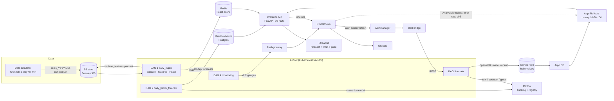

# Architecture



## Layers and dependency direction

```
cli / DAGs / serving  ->  demandops (library)  ->  S3 / MLflow / Postgres / Redis
```

`src/demandops` never imports Airflow, FastAPI request objects or Kubernetes: the same functions run in a
notebook, the CLI, an Airflow task and the API. `pipelines/` holds the orchestration glue
(promotion gates, GitOps PR, the DAG files) and imports the library, never the other way round.

## The one idea that holds the platform together: direct 28-day features

Every feature of target day *t* uses only data up to *t - 28* (`features/lags.py`, `rolling.py`). So:

* **one global LightGBM model** predicts any day of the horizon without recursive forecasting;
* the complete feature vector for each of the next 28 days is computable **today**; DAG 1 publishes it once
  (`features/store.py`, key `"<series id>|<day>"`) to the offline store and Feast materialises it into Redis;
* the **same** `build_features` function creates the training matrix and the serving features, so there is no
  training/serving skew;
* the "no leakage" property is a unit test (`tests/unit/test_features.py`): corrupt all data after *t - 28* and
  the features of *t* must not change.

## Online vs. batch inference

| | Batch (DAG 2) | Online (API) |
|---|---|---|
| Purpose | nightly forecast for all 30,490 series into Postgres; feeds the reorder policy and the Streamlit tables | interactive questions and **what-if price** |
| Features | `horizon_features.parquet` (offline) | Feast/Redis lookup (or parquet fallback) |
| Model | `champion` alias | version pinned in git (`model.version`) so a rollout is a reviewable commit |

## Closed loop

1. DAG 4 computes PSI per feature, realised WAPE and realised bias of past forecasts (baseline WAPE = the
   champion's own backtest WAPE from MLflow) and pushes gauges to the Pushgateway.
2. `PrometheusRule` fires `DemandDataDrift` (>= 30 % of features), `DemandForecastErrorDrift` (WAPE 25 % above
   baseline), `DemandForecastBias` (|bias| >= 25 %) or `DemandTargetDrift` (sales PSI >= 0.25), all labelled
   `action=retrain`. The last two exist because a real test showed the first two miss a 4x demand shock:
   WAPE saturates on intermittent data (0.79 -> 0.88) while the bias was -74 %.
3. Alertmanager routes them to `alert-bridge`, which calls the Airflow REST API to trigger DAG 3.
4. DAG 3 trains a challenger, backtests it (3 rolling-origin folds), and applies the gates
   (`pipelines/gates.py`): WRMSSE better by >= 1 %, |bias| < 5 %, p95 < 100 ms, no data-quality failures.
   The accuracy gate scores the **frozen champion on the challenger's latest holdout window** (not the metrics
   stored when the champion was trained: those cover a different period); the bias gate uses the challenger's
   mean over folds. After a regime change the bias gate keeps blocking until the new regime fills the lag windows.
5. If all gates pass: `challenger` becomes `champion` in MLflow and a PR changes only `model.version`.
   Merging it makes Argo CD sync; Argo Rollouts shifts 10 % -> 50 % -> 100 % of traffic while an
   `AnalysisTemplate` watches the canary's 5xx rate and p95; a failing analysis aborts and rolls back.
6. Otherwise the DAG ends with "kept champion" and an e-mail with the reasons.

## Environments

| | Laptop | VPS |
|---|---|---|
| Cluster | k3d (OpenTofu `envs/local`) | k3s (OpenTofu `envs/vps` + Ansible) |
| Registry | k3d local registry | Harbor with proxy-cache projects |
| Values | `values-local.yaml` (100 series) | `values-vps.yaml` (all series, TLS) |
| Everything else | identical: Argo CD installs the same Applications | |

Moving to AWS later means replacing only `infra/tofu/modules` (EKS, S3, RDS); charts and pipelines stay.
